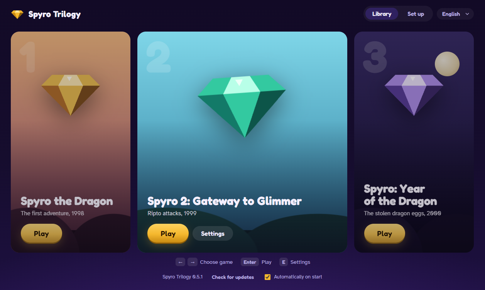
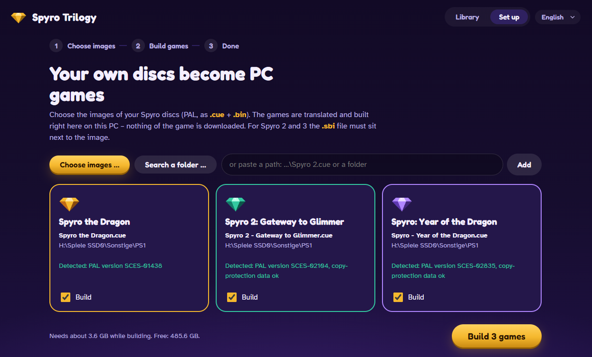
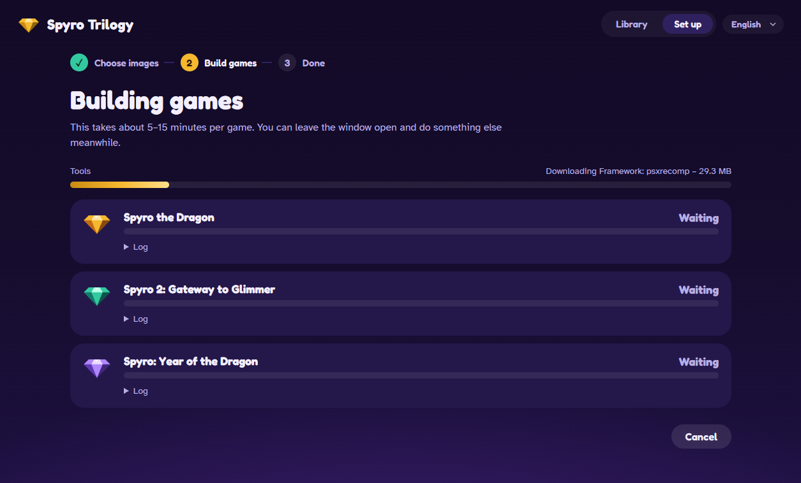

# Spyro Trilogy

Native PC ports of the three PlayStation Spyro games (PAL/Europe) – **no
emulation**, built from **your own** discs.

Spyro Trilogy is a Windows app that turns disc images of Spyro the Dragon,
Spyro 2: Gateway to Glimmer and Spyro: Year of the Dragon into native PC games
through static recompilation ([PSXRecomp](https://github.com/mstan/psxrecomp)),
and launches them. This repository contains **no game data, no game code and
no prebuilt games** – everything is created on your PC from your images.



## Features

- **Guided setup:** pick your images (or a folder). The app identifies and
  verifies them (serial, size, SHA-1, LibCrypt `.sbi`) and builds the games
  you choose.
- **Library:** launch and configure all three games – with mouse, keyboard or
  controller.
- **Per-game settings:** fullscreen, VSync, internal resolution (up to 8×),
  antialiasing, texture filtering, wobble fix (PGXP), CRT filter, volume, and
  keyboard and controller bindings.
- **In-game menu** (F10 · Ctrl+L · Select+L3) in the app's style.
- **Updates from inside the app:** checks GitHub for a new release on start,
  downloads it (checksum-verified) and restarts into it. Can be switched off.
- **Languages:** English and German.

## Screenshots

| Setup | Building |
|---|---|
|  |  |

## Supported discs

| Game | Serial | Note |
|---|---|---|
| Spyro the Dragon | SCES-01438 | |
| Spyro 2: Gateway to Glimmer | SCES-02104 | `.sbi` required |
| Spyro: Year of the Dragon | SCES-02835 | `.sbi` required |

Images as `.cue` + `.bin` (Redump dumps). For Spyro 2 and 3 the matching
`.sbi` file must sit next to the `.cue` with the same name.

## Usage

1. Download the app (Releases) or package it yourself (see below).
2. Run `Spyro Trilogy.exe` → **Start setup** → choose your images →
   **Build games**. On first use the app downloads its tools once (Python,
   Clang/CMake, the PSXRecomp framework, about 400 MB). After that each game
   takes about 5–15 minutes to build.
3. Click **Play** in the library.

Data is stored in `%LOCALAPPDATA%\SpyroTrilogy`.

## Packaging it yourself (Windows)

Requires Python 3.11–3.13 (not 3.14, because of pythonnet).

```powershell
powershell -ExecutionPolicy Bypass -File .\package.ps1          # EXE + ZIP in dist\
powershell -ExecutionPolicy Bypass -File .\package.ps1 -RunOnly  # run directly
```

## Publishing a release

`package.ps1` creates `dist\SpyroTrilogy-<version>.zip` and
`dist\SpyroTrilogy-<version>.zip.sha256`. Attach **both** to the GitHub
release (tag `v<version>`): the in-app updater only installs a release whose
checksum file is present. It follows the latest non-prerelease release.

## Layout

| Path | Contents |
|---|---|
| `app.py` | Window (pywebview/WebView2); development server with `--serve` |
| `backend/` | Disc checks, build pipeline, settings, controls, framework patches |
| `ui/` | User interface (HTML/CSS/JS), translations, fonts |
| `kits/spyro1-3/` | Per-game project files (without generated code), in-game menu, fixes |
| `kits/common/` | Shared source of the in-game menu (`spyro_menu*.cpp`) |

## Licences and notes

- Spyro Trilogy is licensed under the **PolyForm Noncommercial License 1.0.0**
  (see `LICENSE`): you may use, modify and share it, but not commercially. The
  fonts are excluded (own licence, see below).
- PSXRecomp is also licensed under the PolyForm Noncommercial License 1.0.0.
  The app downloads it on first run and does not include it. Games built with
  it must not be used commercially.
- recomp-ui: MIT licence.
- Fonts: Fredoka and Atkinson Hyperlegible, SIL Open Font License 1.1
  (licence texts in `ui/fonts/` and `kits/*/assets/spyro/`).
- Unofficial fan project, not affiliated with Sony Interactive Entertainment,
  Insomniac Games, Toys for Bob or Activision. "Spyro" is a trademark of its
  respective owners.
